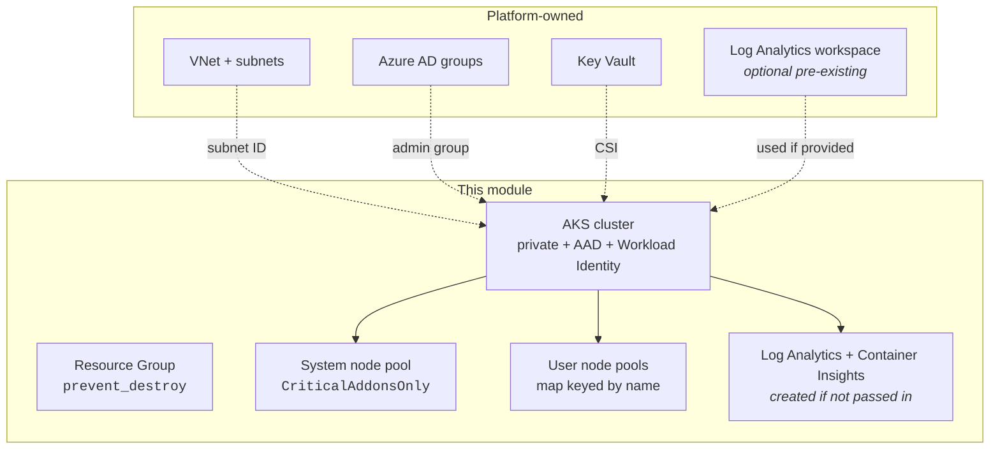

# aks-terraform-module

[](https://github.com/shohrabniaz/aks-terraform-module/actions/workflows/ci.yml)
[](LICENSE)
[](versions.tf)

Opinionated Terraform module for **production Azure Kubernetes Service (AKS)** clusters. Built for platform teams that want a secure, observable default without dragging in their own networking: a private API server, Azure AD–only access, Container Insights and Azure Policy on by default, and clean separation of system and user node pools.

> **Status:** reference module, not published to the Terraform Registry. Pin by Git ref:
> `source = "git::https://github.com/shohrabniaz/aks-terraform-module.git//?ref=v0.1.0"`

---

## Table of contents

- [Why this module exists](#why-this-module-exists)
- [Features](#features)
- [Architecture](#architecture)
- [Requirements](#requirements)
- [Quick start](#quick-start)
- [Security hardening choices](#security-hardening-choices)
- [Inputs](#inputs)
- [Outputs](#outputs)
- [Operational considerations](#operational-considerations)
- [Continuous integration](#continuous-integration)
- [Repository layout](#repository-layout)
- [License](#license)
- [Maintainer](#maintainer)

## Why this module exists

Most AKS modules on the registry are either too thin ("here's a cluster, good luck") or too heavy (they create their own VNet, resource groups and opinionated network topology). In real platform engineering the network is almost always owned separately. This module assumes that split and focuses on a secure, well-instrumented cluster:

- Assumes the **VNet/subnet is already provisioned** by a platform team (bring-your-own networking).
- Ships **secure-by-default** settings that you have to *explicitly* opt out of, rather than opt into.

If you want the opposite — a public cluster, local kubeconfigs, no policy add-on — the variables let you do that, but the insecure path is never the default.

## Features

- Defaults to a **private cluster** (no public API server endpoint).
- **Azure AD + Azure RBAC** with local accounts disabled — no `--admin` bypass.
- **Container Insights** wired in; reuses an existing Log Analytics workspace or creates one.
- **Azure Policy add-on** (Gatekeeper / OPA) enabled by default.
- **OIDC issuer + Workload Identity** enabled together, ready for federated pod identity.
- Clean split of **system** (`CriticalAddonsOnly`) and **user/workload** node pools, each with cluster autoscaling.
- **Spot node pool** support for non-critical, interruptible workloads.
- **Azure CNI in Overlay mode with Cilium** network policy (no VNet IP burned per pod).
- **Maintenance window** so control-plane/node upgrades don't surprise on-call.
- Resource group protected with `prevent_destroy`.

## Architecture



## Requirements

| Requirement | Version |
|---|---|
| Terraform | `>= 1.6.0, < 2.0.0` |
| `hashicorp/azurerm` provider | `~> 3.110` |
| `hashicorp/azuread` provider | `~> 2.50` |
| `hashicorp/random` provider | `~> 3.6` |

Pre-existing Azure resources the module **does not** create and expects you to provide:

- A **VNet and subnet** for the node pools (the subnet needs a `/24` or larger free range for the system pool).
- An **Azure AD group** whose object ID is passed via `azure_ad_admin_group_object_ids`. It must exist *before* you apply, otherwise local accounts are disabled and you can lock yourself out.
- Apply-time identity with **Contributor** on the subscription and **User Access Administrator** on the target resource group (for the role assignments AKS performs internally).

## Quick start

```hcl
module "aks" {
  source = "git::https://github.com/shohrabniaz/aks-terraform-module.git//?ref=v0.1.0"

  name                = "demo-aks"
  location            = "australiaeast"
  resource_group_name = "demo-aks-rg"

  vnet_subnet_id                  = data.azurerm_subnet.aks.id
  azure_ad_admin_group_object_ids = [var.aks_admin_group_oid]

  user_node_pools = {
    apps = {
      vm_size   = "Standard_D4s_v5"
      min_count = 2
      max_count = 10
    }
  }

  tags = {
    environment = "demo"
    owner       = "platform"
  }
}
```

See [`examples/basic/`](examples/basic/) for a fuller example that also provisions a spot pool.

## Security hardening choices

Security is the default posture, not an add-on. The table below maps each control to the variable/behaviour that enforces it and the reasoning behind it.

| Control | How it's enforced | Why |
|---|---|---|
| Private API server | `private_cluster_enabled = true` (default) | Keeps the control plane off the public internet; `kubectl` works only from inside the VNet (or peered network / Bastion / jumpbox). |
| Azure AD–only auth | `local_account_disabled = true`, AKS-managed AAD integration | No static kubeconfig / `--admin` bypass; every access path goes through Azure AD. |
| Azure RBAC | `azure_rbac_enabled = true` | Authorization is managed in Azure, not in-cluster `RoleBinding`s. |
| Admission policy | `azure_policy_enabled = true` (default) | Gatekeeper/OPA enforces organisational guardrails at admission time. |
| Workload Identity | OIDC issuer + Workload Identity enabled together | Federated pod identity instead of long-lived secrets. |
| Secret management | Key Vault Secrets Provider (CSI) with rotation every `5m` | Secrets stay in Key Vault and are projected into pods, not baked into manifests. |
| Observability | Container Insights via managed-identity (`msi_auth_for_monitoring_enabled`) | Audit/diagnostic signal available from day one, no shared keys. |
| Blast-radius control | Resource group `prevent_destroy` | An accidental `terraform destroy` cannot delete the RG and anything placed in it. |
| Restricted public access | `authorized_ip_ranges` (only when the cluster is public) | If you must run a public API server, access is still IP-allowlisted. |

**Opting out is explicit.** For example, `private_cluster_enabled = false` requires you to also set `authorized_ip_ranges`, and disabling the admin group is simply not possible — you must supply one.

### Security scanning & documented risk acceptance

CI runs [Checkov](https://www.checkov.io/) over the whole tree (see [Continuous integration](#continuous-integration)). A small set of Checkov policies are suppressed **inline, next to the resource, each with a written justification** — see [`modules/cluster/main.tf`](modules/cluster/main.tf) and [`modules/node-pools/main.tf`](modules/node-pools/main.tf). These are deliberate, auditable risk-acceptance decisions, not blanket exemptions; any *new* finding still fails the build.

| Checkov ID | Decision | Rationale |
|---|---|---|
| `CKV_AZURE_117` | Accepted | OS disks are Ephemeral and encrypted with platform-managed keys. Customer-managed disk encryption sets need caller-owned Key Vault + DiskEncryptionSet infrastructure, which is out of scope for this bring-your-own-infra module. |
| `CKV_AZURE_227` | Deferred to caller | Host-based encryption (`EncryptionAtHost`) requires the subscription-level feature to be registered and is unsupported on several VM sizes; forcing it would break applies. |
| `CKV_AZURE_232` | False positive | `only_critical_addons_enabled` is driven by `var.system_node_pool.only_critical_addons` and defaults to `true`; Checkov cannot resolve the optional-object default statically. |
| `CKV_AZURE_171` | Accepted | The Kubernetes minor version is operator-controlled by design; an automatic upgrade channel is intentionally not forced so version bumps stay an explicit decision. |
| `CKV_AZURE_168` | Accepted | Azure CNI Overlay's default `max_pods` (250) already exceeds the 50-pod minimum; `max_pods` is not pinned so the overlay default applies. |

## Inputs

| Name | Type | Default | Description |
|---|---|---|---|
| `name` | string | — | Base name for the cluster (1–30 chars). |
| `location` | string | — | Azure region. |
| `resource_group_name` | string | — | Resource group (created with `prevent_destroy`). |
| `vnet_subnet_id` | string | — | Subnet for the system node pool. |
| `azure_ad_admin_group_object_ids` | list(string) | — | AAD groups that get cluster-admin. |
| `kubernetes_version` | string | `"1.29"` | Minor version; AKS patch bumps are ignored on plan. |
| `sku_tier` | string | `"Standard"` | Use `Standard`/`Premium` in production for an SLA. |
| `private_cluster_enabled` | bool | `true` | Disable only with a clear reason. |
| `authorized_ip_ranges` | list(string) | `[]` | Ignored when the private cluster is on. |
| `service_cidr` | string | `"10.96.0.0/16"` | In-cluster Kubernetes service range. |
| `dns_service_ip` | string | `"10.96.0.10"` | In-cluster CoreDNS IP (must sit inside `service_cidr`). |
| `system_node_pool` | object | see `variables.tf` | Defaults to 2–4 × `D4s_v5` across 3 zones, `CriticalAddonsOnly`. |
| `user_node_pools` | map(object) | `{}` | Workload pools keyed by name (autoscaling, labels, taints, spot). |
| `log_analytics_workspace_id` | string | `null` | If null, the module creates a workspace. |
| `log_retention_days` | number | `30` | Retention for the module-created workspace. |
| `enable_key_vault_secrets_provider` | bool | `true` | Key Vault Secrets Provider (CSI driver). |
| `enable_azure_policy` | bool | `true` | Azure Policy / Gatekeeper add-on. |
| `enable_workload_identity` | bool | `true` | OIDC issuer + Workload Identity. |
| `maintenance_window` | object | Sun 18:00 UTC, 4h | Control-plane upgrade window. |
| `tags` | map(string) | `{}` | Applied to everything the module creates. |

## Outputs

| Name | Description |
|---|---|
| `cluster_id` | AKS resource ID. |
| `cluster_name` | AKS name. |
| `kube_config_raw` | Raw kubeconfig (sensitive). |
| `kubelet_identity_object_id` | For `AcrPull` / Key Vault role assignments. |
| `oidc_issuer_url` | Needed to configure federated workload identity. |
| `log_analytics_workspace_id` | Workspace used for Container Insights. |
| `resource_group_name` | RG containing the cluster. |

## Operational considerations

**Cost**
- The defaults run ≈ AUD $400–700/month per cluster in `australiaeast` before any workloads. Drivers: 2× system `D4s_v5`, Log Analytics ingestion, standard load balancer. For ephemeral dev environments, set `sku_tier = "Free"` and consider pointing at a shared workspace.

**Scaling limits**
- AKS hard limits are 5000 nodes per cluster and 1000 nodes per pool. The practical limit is much lower — past ~200 nodes you hit etcd / API-server pressure unless sized accordingly.
- The Cilium dataplane runs in `Overlay` mode here: a small performance trade-off in exchange for not consuming a VNet IP per pod, which matters at scale.

**Upgrades**
- `kubernetes_version` pins the minor version. AKS patch bumps within that minor are ignored on plan (`lifecycle.ignore_changes`) so they don't show up as drift.
- The maintenance window constrains *when* AKS may run upgrades. Bumping the minor version triggers a rolling upgrade with `max_surge = 33%` — verify your `PodDisruptionBudget`s before applying in production.

**Lock-out risk**
- Because `local_account_disabled = true` and `private_cluster_enabled = true`, make sure the admin AAD group exists and you have VNet connectivity before applying, or you will not be able to reach the cluster.

## Continuous integration

[`.github/workflows/ci.yml`](.github/workflows/ci.yml) runs on every PR and push to `main`:

- `terraform fmt -check -recursive`
- `terraform init -backend=false` + `terraform validate` for the root module, each submodule and the example
- `tflint --recursive`
- **`checkov`** static security analysis across the whole tree (the security gate)

To reproduce locally:

```bash
terraform fmt -check -recursive
terraform validate            # per directory, after `terraform init -backend=false`
tflint --recursive
checkov -d .
```

## Repository layout

```
.
├── main.tf                # root module: RG + wiring of submodules
├── variables.tf           # root inputs
├── outputs.tf             # root outputs
├── versions.tf            # Terraform + provider constraints
├── modules/
│   ├── cluster/           # the AKS cluster + system node pool
│   ├── node-pools/        # user/workload node pools
│   └── monitoring/        # Log Analytics workspace + Container Insights
├── examples/
│   └── basic/             # minimal consumer example (apps + spot pool)
└── .github/workflows/ci.yml
```

## License

Released under the [MIT License](LICENSE).

## Maintainer

**Shohrab Hossen Niaz** — Senior DevOps Engineer, focused on Infrastructure-as-Code security. This module is part of a portfolio exploring secure-by-default IaC patterns.
