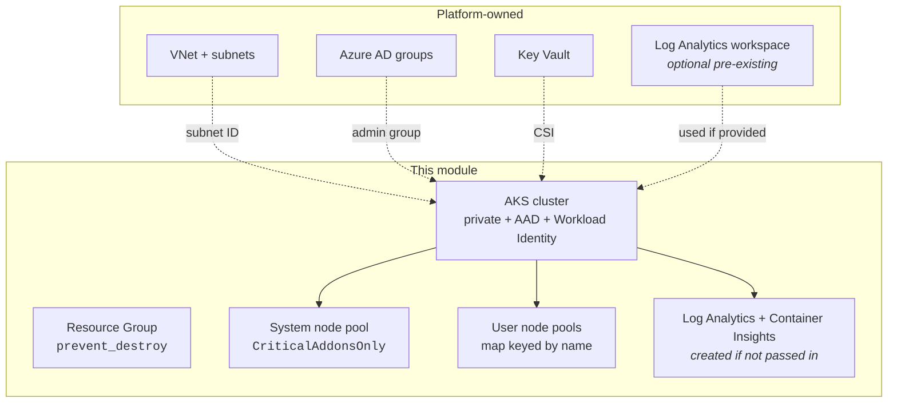

# aks-terraform-module

Opinionated Terraform module for production AKS clusters. Built for teams that need a sane default — secure API server, AAD-only access, observability and policy on, room to grow with spot/user node pools.

> Status: reference module. Not on the Terraform Registry. Pin by Git ref:
> `source = "git::https://github.com/shohrabniaz/aks-terraform-module.git//?ref=v0.1.0"`

## Why this module exists

Every AKS module on the registry is either too thin ("here's a cluster, good luck") or too heavy (drags in its own VNet, its own resource groups, its own opinionated network topology). In real platform engineering you almost always own the network separately. This module:

- ✅ Assumes the **VNet/subnet is already provisioned** by a platform team
- ✅ Defaults to **private cluster** (no public API server)
- ✅ Defaults to **Azure AD + Azure RBAC**, local accounts disabled
- ✅ Defaults to **Container Insights** wired in
- ✅ Defaults to **Azure Policy add-on** (Gatekeeper/OPA)
- ✅ Defaults to **OIDC + Workload Identity** enabled (federated identity ready)
- ✅ Splits **system** and **user** node pools cleanly, with autoscaling
- ✅ **Maintenance window** so patch upgrades don't surprise on-call

If you want the opposite — a public cluster, local kubeconfigs, no policy add-on — the variables let you opt out, but you have to opt out explicitly.

## Architecture



## Quick start

```hcl
module "aks" {
  source = "git::https://github.com/shohrabniaz/aks-terraform-module.git//?ref=v0.1.0"

  name                = "demo-aks"
  location            = "australiaeast"
  resource_group_name = "demo-aks-rg"

  vnet_subnet_id                  = data.azurerm_subnet.aks.id
  azure_ad_admin_group_object_ids = [var.aks_admin_group_oid]

  user_node_pools = {
    apps = {
      vm_size   = "Standard_D4s_v5"
      min_count = 2
      max_count = 10
    }
  }

  tags = {
    environment = "demo"
    owner       = "platform"
  }
}
```

See [`examples/basic/`](examples/basic/) for a fuller example with a spot pool.

## Inputs

| Name | Type | Default | Description |
|---|---|---|---|
| `name` | string | — | Base name for the cluster (1-30 chars). |
| `location` | string | — | Azure region. |
| `resource_group_name` | string | — | Resource group (created with `prevent_destroy`). |
| `vnet_subnet_id` | string | — | Subnet for the system node pool. |
| `azure_ad_admin_group_object_ids` | list(string) | — | AAD groups that get cluster-admin. |
| `kubernetes_version` | string | `"1.29"` | Minor version; patch managed by AKS auto-upgrades. |
| `sku_tier` | string | `"Standard"` | Use `Standard`/`Premium` in production for SLA. |
| `private_cluster_enabled` | bool | `true` | Disable only with a clear reason. |
| `authorized_ip_ranges` | list(string) | `[]` | Ignored when private cluster is on. |
| `service_cidr` / `dns_service_ip` | string | `10.96.0.0/16` / `10.96.0.10` | In-cluster service range. |
| `system_node_pool` | object | see vars | Defaults to 2-4 × `D4s_v5` across 3 zones. |
| `user_node_pools` | map(object) | `{}` | Workload pools keyed by name. |
| `log_analytics_workspace_id` | string | `null` | If null, module creates a workspace. |
| `log_retention_days` | number | `30` | For module-created workspace. |
| `enable_key_vault_secrets_provider` | bool | `true` | CSI driver for Key Vault. |
| `enable_azure_policy` | bool | `true` | Azure Policy / Gatekeeper add-on. |
| `enable_workload_identity` | bool | `true` | OIDC + Workload Identity. |
| `maintenance_window` | object | Sun 18:00 UTC, 4h | Control-plane upgrade window. |
| `tags` | map(string) | `{}` | Applied to everything the module makes. |

## Outputs

| Name | Description |
|---|---|
| `cluster_id` | AKS resource ID. |
| `cluster_name` | AKS name. |
| `kube_config_raw` | Raw kubeconfig (sensitive). |
| `kubelet_identity_object_id` | For `AcrPull` / Key Vault role assignments. |
| `oidc_issuer_url` | Needed to configure federated workload identity. |
| `log_analytics_workspace_id` | Workspace used for Container Insights. |
| `resource_group_name` | RG containing the cluster. |

## Considerations

**Cost**
- The defaults will run ≈ AUD $400-700/month per cluster in `australiaeast` before any workloads. Drivers: 2× system D4s_v5, Log Analytics ingestion, standard load balancer. Use `sku_tier = "Free"` and turn off Container Insights for ephemeral dev environments.

**Scaling limits**
- AKS hard limit is 5000 nodes per cluster, 1000 nodes per pool. Practical operational limit is much lower — past ~200 nodes you start hitting etcd / API server pressure unless you've sized accordingly.
- Cilium dataplane is in `Overlay` mode here; this trades a small perf hit for not burning a VNet IP per pod, which matters at scale.

**Security defaults**
- `local_account_disabled = true` — you cannot bypass AAD even with `--admin`. Make sure your admin group exists *before* applying or you'll lock yourself out.
- `private_cluster_enabled = true` — `kubectl` only works from inside the VNet (or peered, or via a jumpbox / Bastion). Plan that or pass `private_cluster_enabled = false` with `authorized_ip_ranges`.
- `azure_policy_enabled = true` — review the [built-in initiatives](https://learn.microsoft.com/azure/governance/policy/samples/built-in-initiatives) before applying, some default-deny policies will block existing workloads.

**Upgrades**
- `kubernetes_version` controls minor version. Patch upgrades happen during the configured maintenance window and are ignored by Terraform on plan (lifecycle.ignore_changes).
- Module bumps inside the same minor version are non-disruptive. Bumping the minor version triggers a rolling upgrade — drain budget is `max_surge = 33%`, which is sane but verify your `PodDisruptionBudget`s before applying in production.

## CI

`.github/workflows/terraform-validate.yml` runs on every PR/push to main:
- `terraform fmt -check`
- `terraform init -backend=false` + `validate` for the root module and each submodule
- `tflint --recursive`
- `tfsec` on the whole tree

## License

MIT
